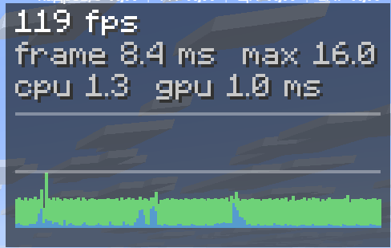

# Vanilla Horizon — local snapshot

Captured by user in-game overlay (vanilla Horizon, no custom pack/mods from this workspace).

**Date:** 2026-11-11

## Overlay readout

| Metric | Value |
| --- | --- |
| FPS | **119** |
| Frame time | **8.4 ms** |
| Max frame time | **16.0 ms** |
| CPU (frame) | **1.3 ms** |
| GPU | **1.0 ms** |

## Notes

- Source: user screenshot of Horizon debug/perf overlay (sky/clouds visible).
- Hardware / render distance / resolution / VSync **not recorded** in this capture — add on next run if comparing builds.
- Treat as a **baseline** for this machine before loading native mods or a future pack.

## Screenshot

